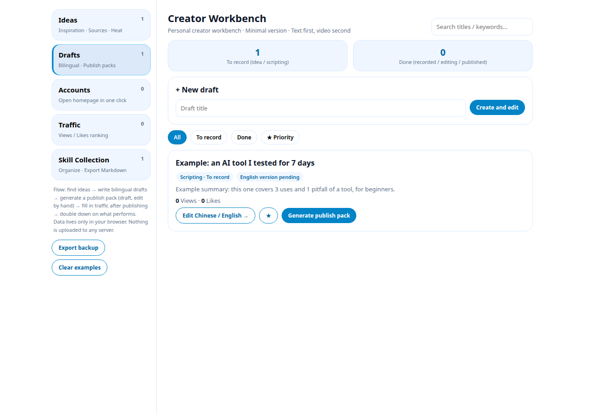
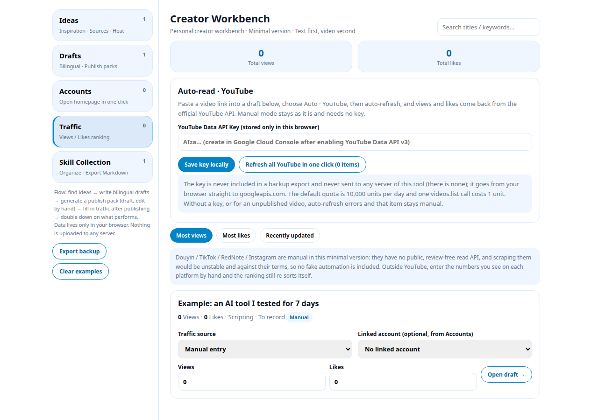
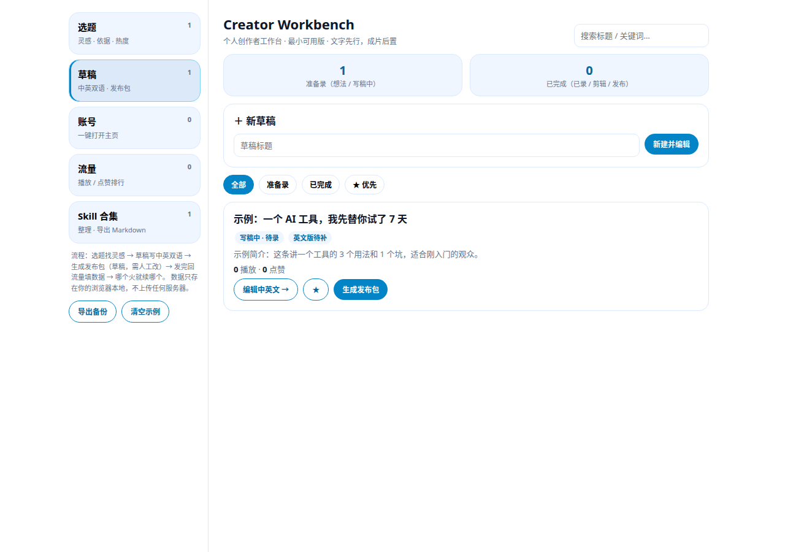

# Creator Workbench — 个人创作者工作台（最小可用版）

[English](#english) · [中文](#中文)



---

## English

A local-first creator workbench that also works on your phone. It gathers topic ideas,
drafts, publish packs, accounts, traffic, and skills in one place, instead of scattered documents.

The page UI itself is in English.

### What it includes (minimal on purpose)

- **Ideas**: save inspiration, hooks, source links, and platforms; star an idea to move it to Drafts in one click
- **Drafts**: write Chinese and English scripts separately, with status
  `idea → scripting → recorded → editing → final → published`
- **Publish packs**: generated from your own script into titles / descriptions / tags.
  **Always a draft** — edit it, then publish manually
  - Rule: only the language that actually has a script gets a title and description;
    a missing language **stays blank and is never auto-translated to fill the gap**
- **Accounts**: only the homepage links you enter yourself, one click to open;
  in Traffic you can link a video to one of these accounts
- **Traffic: manual + automatic modes**
  - **Manual**: after publishing, type in the views / likes you see on each platform and the ranking re-sorts itself
  - **Automatic · YouTube**: paste a video link in Traffic (watch / youtu.be / Shorts all work),
    enter a YouTube Data API Key once, and click refresh. Views and likes come back from the
    official YouTube API, with a last-synced timestamp. Auto-refresh overwrites manual numbers;
    switch back to manual if you want to keep hand-entered numbers
  - Douyin / TikTok / RedNote / Instagram are manual in this minimal version: they have no
    public, review-free read API, and scraping them would be unstable and against their terms,
    so no fake automation is included

  
- **Skill collection**: organize your methods and export them as `skills.md` in one click

### Setting up YouTube auto-read (once)

1. Open [Google Cloud Console](https://console.cloud.google.com/) and create a project
2. Enable **YouTube Data API v3**
3. Create an API Key (restrict it to YouTube Data API v3 calls only)
4. Back in this workbench, open Traffic, paste the key, and click save

The default quota is 10,000 units per day; one video statistics lookup costs 1 unit, which is plenty for personal use.

### What it deliberately does not do

- No backend, no database, no login
- No automatic uploads, and it never posts to any platform for you
- No real scripts, accounts, or business content are shipped: the built-in items are clearly
  labelled generic examples and can be cleared in one click

### Where your data lives

- Workbench data lives only in your browser's `localStorage`. It does not sync across devices;
  use “Export backup” in the sidebar to save a JSON copy of important drafts
- **Your YouTube API Key is stored separately, is never included in the backup export, and is
  never sent to any server of this tool** (there is none); it goes from your browser straight to `googleapis.com`

### Quick start

```bash
npm install
npm run dev
```

Open the local address shown in the terminal. To build:

```bash
npm run build
npm run preview
```

Requires Node 18+.

### One-click upload to GitHub

First make sure your local GitHub identity is your own account (the script checks it and stops
if it does not match, so it never pushes under the wrong account):

```bash
./upload.sh creator-workbench
```

With no argument, the default repository name is also `creator-workbench`. The script:

1. Scans the files to be pushed for business names or private information (excluding `.git`)
2. Verifies the `gh auth` login
3. Creates a public repository if there is none, otherwise pushes to it
4. Pushes to the `main` branch, and fails loudly on commit errors instead of creating an empty repository

If `gh` is not logged in yet, run `gh auth login` first.

## 中文

一个本地优先、手机也能用的创作者工作台：把选题、草稿、发布包、账号、流量、Skill
收进一个地方，不再散落在各处文档里。

页面界面本身为英文。



### 它有什么（只留最基本的）

- **选题**：记灵感、钩子、依据链接、平台，★ 后一键移到草稿
- **草稿**：中英双语分开写，状态从 `想法 → 写稿中 → 已录制 → 剪辑中 → 定稿 → 已发布`
- **发布包**：从你自己的稿子生成标题 / 简介 / 标签，**永远是草稿**，改完再手动发布
  - 规则：有哪种语言的稿子，就生成哪种语言；缺的语言**留空，不自动翻译凑数**
- **账号**：只存你自己填的主页链接，一键打开；流量里可以把一条视频链接到某个账号
- **流量：手动 + 自动两种模式**
  - **手动**：发完片后，把各平台看到的播放 / 点赞填进来，排行自动重排
  - **自动 · YouTube**：在流量页贴视频链接（watch / youtu.be / Shorts 都行），填一次
    YouTube Data API Key，点「自动刷新」，播放和点赞就从 YouTube 官方 API 读回来，
    还会记上次同步时间。自动刷新会覆盖手动填的数字，想保留手动数就切回手动模式
  - 抖音 / TikTok / 小红书 / Instagram 在这个最小版里是手动：它们没有公开免审核的
    读取接口，硬爬不稳定也不合规，所以不做假自动

  
- **Skill 合集**：整理你的方法论，一键导出 `skills.md`

### YouTube 自动读取怎么开通（只需要一次）

1. 打开 [Google Cloud Console](https://console.cloud.google.com/)，新建一个项目
2. 启用 **YouTube Data API v3**
3. 创建 API Key（限制一下：只允许 YouTube Data API v3 调用）
4. 回到本工作台的「流量」页，把 Key 粘贴进去，点「保存 Key 到本地」

默认配额每天 10,000 单位，一次视频数据查询只要 1 单位，个人用完全够。

### 它没有（故意不做）

- 没有后端、没有数据库、没有账号登录
- 不自动上传视频，不替你发任何平台
- 不含任何真实稿子、真实账号、真实业务内容：内置的只是标着「示例」的通用占位，可一键清空

### 数据存在哪里

- 工作台数据只存在你浏览器的 `localStorage` 里。换设备不会同步；重要稿子请点侧栏「导出备份」存成 JSON
- **YouTube API Key 单独存放，不会随备份导出，也不会发给本工具的任何服务器**（本工具没有服务器）；
  Key 只在浏览器里直接发给 `googleapis.com`

### 快速开始

```bash
npm install
npm run dev
```

打开终端显示的本地地址即可使用。打包：

```bash
npm run build
npm run preview
```

需要 Node 18+。

### 一键上传到 GitHub

先确认你本地的 GitHub 身份是你自己的账号（脚本会先核验，身份不对会直接停下，不会推错账号）：

```bash
./upload.sh creator-workbench
```

不传参数时默认仓库名也是 `creator-workbench`。脚本会：

1. 先扫一遍将要推送的文件，确认没有业务名、私人信息残留（排除 `.git`）
2. 核验 `gh auth` 的登录账号
3. 没有仓库就新建公开仓库，有就直接推
4. 推到 `main` 分支，提交失败会直接报错，不会建一个空仓库

如果你的 `gh` 还没登录，先跑 `gh auth login`。

---

## 开源协议 / License

MIT，见 `LICENSE` / See `LICENSE`.
